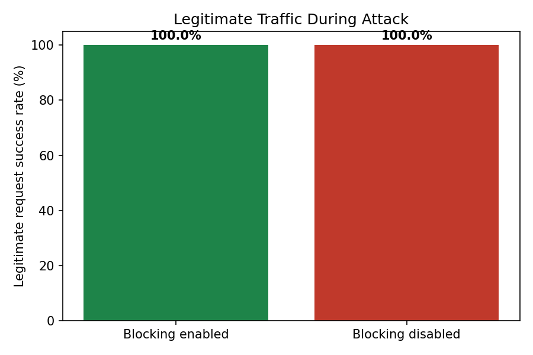
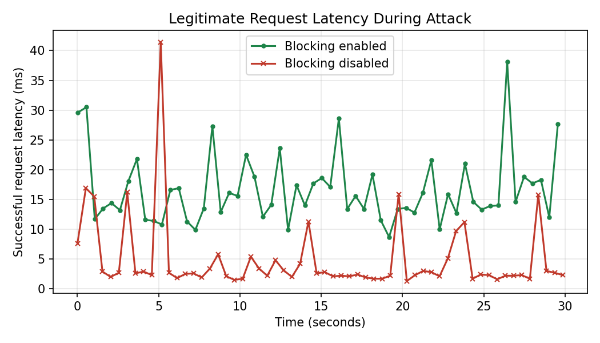

# Dynamic Host Blocking System (SDN + TCP Sockets)

A software-defined networking (SDN) project that detects abnormal TCP connection activity and dynamically blocks suspicious hosts using OpenFlow rules.

The system combines a custom multithreaded TCP socket application, a Mininet network topology, Open vSwitch, and a Ryu SDN controller.

The project was developed across two deliverables:

- **Deliverable 1 (D1):** TCP socket communication, traffic generation, connection-rate monitoring, and dynamic host blocking.
- **Deliverable 2 (D2):** Extended six-host topology, multi-attacker handling, automatic blocking and unblocking, robustness testing, and performance evaluation.

## Team Details

| Name | SRN | Contribution |
|---|---|---|
| Abhinav Akinepalli | PES1UG25CS013 | Ryu SDN controller (`controller/`), D2 dynamic blocking and unblocking, integration testing, test cases, design document |
| Deeksha A | PES1UG26CS813 | TCP socket application (`app/`), architecture diagram, design document, D2 performance evaluation, comparison graphs (`performance/`), README |
| Adithyan | PES1UG25CS028 | Mininet topology (`topology/`), D2 six-host topology extension, documentation |

## 1. Project Overview

Traditional networks often depend on manually configured rules to restrict suspicious traffic.

The Dynamic Host Blocking System (DHBS) demonstrates how an SDN controller can automate this process.

The Ryu controller monitors new TCP connection attempts, identifies hosts exceeding a configured threshold, and installs OpenFlow DROP rules on the switch.

Blocking is temporary. After the configured timeout, the system automatically processes the expiration of the blocking rule.

The system is designed to preserve communication between legitimate clients and the TCP server while isolating suspicious hosts.

## 2. System Functionality

| Feature | Implementation |
|---|---|
| TCP client-server communication | Custom Python socket application |
| Normal traffic generation | `app/client.py` |
| Attack traffic generation | `app/attacker.py` |
| Network emulation | Mininet and Open vSwitch |
| Connection monitoring | Ryu controller tracks new TCP connection attempts |
| Suspicious traffic detection | More than 20 new connections within 5 seconds |
| Dynamic host blocking | Source-IP-specific OpenFlow DROP rules |
| Temporary blocking | Initial 60-second block duration |
| Automatic unblocking | Blocking expires after the configured timeout |
| Multiple attackers | D2 topology supports three attacker hosts |
| Event logging | `logs/controller_events.log` |
| Performance evaluation | CSV measurements and comparison graphs |

## 3. Network Architecture

### Deliverable 1

The initial implementation used normal client hosts, an attacker, a TCP server, and an OpenFlow switch controlled by Ryu.

The controller monitored connection activity and installed DROP rules when suspicious behavior was detected.

### Deliverable 2 — Extended Topology

D2 extends the topology to six hosts connected to one OpenFlow 1.3 switch.

```text
 n1   (10.0.0.1) ───┐
 n2   (10.0.0.2) ───┤
 atk  (10.0.0.3) ───┤
 srv  (10.0.0.4) ───┼── s1 (Open vSwitch)
 atk2 (10.0.0.5) ───┤         |
 atk3 (10.0.0.6) ───┘         |
                              | OpenFlow 1.3
                              | TCP port 6653
                              |
                         Ryu Controller
                       (Detection + Blocking)
```

### Host Configuration

| Host | IP Address | Role |
|---|---|---|
| n1 | 10.0.0.1 | Legitimate client |
| n2 | 10.0.0.2 | Legitimate client |
| atk | 10.0.0.3 | Attacker 1 |
| srv | 10.0.0.4 | TCP server |
| atk2 | 10.0.0.5 | Attacker 2 |
| atk3 | 10.0.0.6 | Attacker 3 |

The server is excluded from attacker blocking.

## 4. How Dynamic Blocking Works

1. A client initiates a TCP connection toward the server.
2. The Ryu controller monitors new TCP connection attempts.
3. Connection activity is tracked separately for each source IP.
4. A host exceeding the configured threshold is identified as suspicious.
5. The controller installs a priority-100 OpenFlow DROP rule for that source IP.
6. Traffic matching the DROP rule is discarded by the switch.
7. After the blocking timeout, the controller processes the rule expiration and unblocks the host.
8. Continued suspicious activity can trigger further blocking.

### Detection Parameters

| Parameter | Default | Environment Override |
|---|---|---|
| Connection threshold | 20 | `DHBS_THRESHOLD` |
| Sliding window | 5 seconds | `DHBS_WINDOW` |
| Initial block duration | 60 seconds | `DHBS_BLOCK_SECONDS` |

A host is flagged when it generates more than 20 new TCP connections within a five-second window.

## 5. Prerequisites

The project was developed and tested using:

- Ubuntu 22.04
- Python
- Mininet
- Open vSwitch
- OpenFlow 1.3
- Ryu SDN controller
- Python 3.9 virtual environment for Ryu

## 6. Installation and Setup

### Install Mininet and Open vSwitch

```bash
sudo apt update
sudo apt install -y mininet openvswitch-switch
```

### Set Up the Ryu Environment

```bash
curl -LsSf https://astral.sh/uv/install.sh | sh

uv venv --seed --python 3.9 ~/ryu-env

source ~/ryu-env/bin/activate

pip install setuptools==67.6.1 wheel pbr eventlet==0.30.2

pip install --no-build-isolation ryu
```

### Clone the Repository

```bash
git clone https://github.com/deekshaa-10/dynamic-host-blocking-sdn.git

cd dynamic-host-blocking-sdn
```

## 7. Running the D2 System

Open two Ubuntu terminals.

### Terminal 1 — Start the Ryu Controller

```bash
cd ~/dynamic-host-blocking-sdn

source ~/ryu-env/bin/activate

ryu-manager --ofp-tcp-listen-port 6653 controller/dhbs_controller_d2.py
```

Keep this terminal running.

### Terminal 2 — Start Mininet

```bash
cd ~/dynamic-host-blocking-sdn

sudo mn -c

sudo python3 topology/topology.py
```

Inside the Mininet CLI, verify the available nodes:

```bash
nodes
```

Expected nodes:

```text
atk atk2 atk3 c0 n1 n2 s1 srv
```

Verify controller connectivity:

```bash
sh ovs-vsctl get Controller s1 is_connected
```

Expected output:

```text
true
```

### Start the TCP Server

Inside Mininet:

```bash
srv python3 app/server.py &
```

### Generate Normal Traffic

```bash
n1 python3 app/client.py --server 10.0.0.4
```

### Generate Attack Traffic

For a single-attacker test:

```bash
atk python3 app/attacker.py --server 10.0.0.4 --mode conn-flood --rate 50 --duration 20
```

For the three-attacker robustness experiment, refer to the documented commands in the multi-attacker test report.

## 8. Verify Dynamic Blocking

### Controller Logs

Inspect detection and blocking events:

```bash
cat logs/controller_events.log
```

Example event:

```text
BLOCK host=10.0.0.3
```

### OpenFlow DROP Rules

From the Mininet CLI:

```bash
sh ovs-ofctl -O OpenFlow13 dump-flows s1
```

An attacker-specific DROP rule has the form:

```text
priority=100,ip,nw_src=10.0.0.3 actions=drop
```

The absence of forwarding actions causes matching packets to be dropped.

### Automatic Unblocking

After the blocking timeout, the controller records an UNBLOCK event.

These events can be inspected in `logs/controller_events.log`.

## 9. D2 Multi-Attacker Robustness Testing

The extended topology was evaluated using three attackers:

- `atk` — 10.0.0.3
- `atk2` — 10.0.0.5
- `atk3` — 10.0.0.6

Each attacker generated TCP connection traffic toward the same server.

### Observed Results

| Test | Result |
|---|---|
| Six-host topology initialization | PASS |
| Detection of attacker 1 | PASS |
| Detection of attacker 2 | PASS |
| Detection of attacker 3 | PASS |
| Three simultaneous DROP rules | PASS |
| Legitimate n1 requests | 174/174 successful |
| Legitimate n2 connectivity | 0% packet loss |
| Automatic unblocking | PASS |

The OpenFlow switch contained separate DROP rules for all three attacking source IP addresses.

The controller also recorded individual BLOCK and UNBLOCK events.

These observations demonstrate independent attacker handling and concurrent switch-level blocking while legitimate communication remained available.

**Detailed test procedure, observations, and screenshots:**

[Multi-Attacker Robustness Test Report](docs/multi_attacker_test.md)

## 10. Performance Evaluation

A comparative experiment was performed to evaluate legitimate TCP communication under two conditions:

1. Baseline — dynamic blocking disabled.
2. Protected — dynamic blocking enabled.

Both scenarios were tested under attacker-generated TCP connection traffic.

### Performance Results

| Metric | Baseline | Protected |
|---|---:|---:|
| Total requests | 60 | 58 |
| Successful requests | 60 | 58 |
| Failed requests | 0 | 0 |
| Success rate | 100% | 100% |
| Average latency | 4.85 ms | 16.60 ms |
| Median latency | 2.55 ms | 14.60 ms |
| Minimum latency | 1.30 ms | 8.70 ms |
| Maximum latency | 41.40 ms | 38.10 ms |

### 10.1 Request Success Rate

Both scenarios achieved a 100% request success rate.

The baseline completed 60 of 60 requests, while the protected scenario completed 58 of 58 requests.

This shows that legitimate communication remained successful in both configurations.

The experiment did not demonstrate an improvement in request success rate after enabling dynamic blocking.



### 10.2 Response Latency

Average response latency increased from 4.85 ms in the baseline scenario to 16.60 ms in the protected scenario.

Median latency also increased from 2.55 ms to 14.60 ms.

The protected configuration therefore experienced higher latency in the recorded experiment.

Possible contributing factors include controller processing, flow handling, and virtualized environment variability. The measurements do not establish which factor caused the increase.



### 10.3 Performance Interpretation

The experiment demonstrates that the protected system maintained successful legitimate requests while dynamically blocking the attacker.

However, it does not establish improved latency or higher request success rates compared with the baseline.

The observed benefit is automated malicious-host isolation with continued legitimate communication, rather than faster response times.

### 10.4 Performance Files

| File | Description |
|---|---|
| [`baseline_n1.csv`](performance/baseline_n1.csv) | Baseline measurements |
| [`protected_n1.csv`](performance/protected_n1.csv) | Protected measurements |
| [`metrics_client.py`](performance/metrics_client.py) | Performance measurement script |
| [`baseline_switch.py`](performance/baseline_switch.py) | Baseline switch configuration |
| [`plot_comparison.py`](performance/plot_comparison.py) | Comparison graph generation |

The CSV files contain request-level success and latency measurements used for the comparison.

## 11. Repository Structure

```text
dynamic-host-blocking-sdn/
|
|-- app/
|   |-- server.py
|   |-- client.py
|   |-- attacker.py
|
|-- controller/
|   |-- dhbs_controller.py
|   |-- dhbs_controller_d2.py
|
|-- topology/
|   |-- topology.py
|   |-- multi_topology.png
|   |-- multi_block_logs.png
|   |-- multi_drop_rules.png
|   |-- multi_legitimate_traffic.png
|   |-- multi_unblocking.png
|
|-- performance/
|   |-- baseline_switch.py
|   |-- metrics_client.py
|   |-- plot_comparison.py
|   |-- baseline_n1.csv
|   |-- protected_n1.csv
|   |-- success_rate.png
|   |-- latency_over_time.png
|
|-- docs/
|   |-- architecture.png
|   |-- multi_attacker_test.md
|   |-- test_screenshots/
|
|-- logs/
|   |-- controller_events.log
|
|-- README.md
```

The structure highlights the main project components. Additional documentation and evidence files may also be present in the repository.

## 12. Cleanup

Exit the Mininet CLI:

```bash
exit
```

Clean the Mininet environment:

```bash
sudo mn -c
```

Stop the Ryu controller using `Ctrl+C` in its terminal.

## 13. Results and Conclusion

The Dynamic Host Blocking System demonstrates automated detection and mitigation of abnormal TCP connection activity using SDN.

Deliverable 1 established the TCP socket application, network topology, and controller-based host blocking.

Deliverable 2 extended the system with a six-host topology, multiple attackers, dynamic blocking and unblocking, and comparative performance measurements.

The multi-attacker experiment confirmed that the controller could independently detect three attackers and install separate OpenFlow DROP rules while legitimate clients remained connected.

The performance evaluation recorded 100% legitimate request success in both baseline and protected scenarios, although the protected configuration showed higher average latency.

Overall, the project demonstrates functional SDN-based host isolation and automated response to suspicious TCP traffic.

Further testing with repeated trials, varied traffic loads, and larger topologies would help evaluate performance and scalability more comprehensively.
