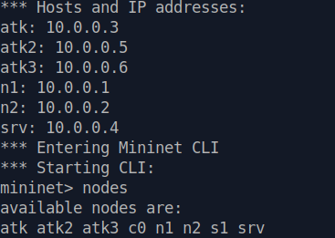
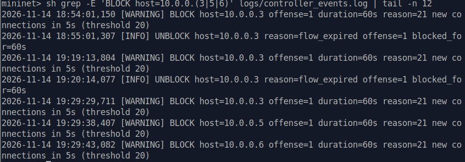
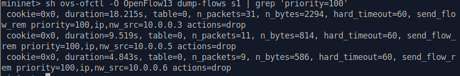
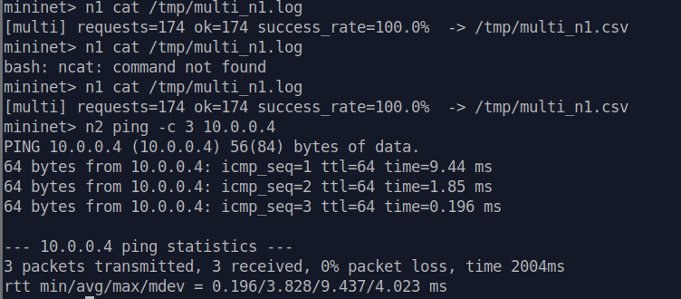
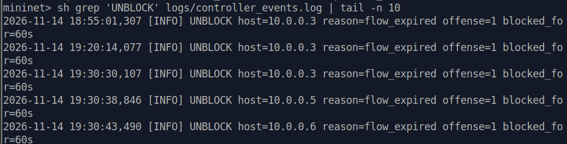

# Multi-Attacker Robustness Testing

## 1. Objective

The objective of this Deliverable 2 experiment is to evaluate the Dynamic Host Blocking System (DHBS) under a multi-attacker scenario.

The existing Mininet topology was extended to support three attackers operating against the same TCP server. The experiment verifies whether the Ryu SDN controller can independently detect malicious hosts, install OpenFlow DROP rules, and automatically unblock hosts after the configured timeout.

It also evaluates whether legitimate clients can continue communicating with the server while the attacks are active.

## 2. Updated Topology

The test network consists of six hosts connected to a single OpenFlow 1.3 switch (`s1`), managed by the Ryu controller (`c0`).

| Host | IP Address | Role |
|---|---|---|
| n1 | 10.0.0.1 | Legitimate client 1 |
| n2 | 10.0.0.2 | Legitimate client 2 |
| atk | 10.0.0.3 | Attacker 1 |
| srv | 10.0.0.4 | TCP server |
| atk2 | 10.0.0.5 | Attacker 2 |
| atk3 | 10.0.0.6 | Attacker 3 |

The Ryu controller communicates with the OpenFlow switch on TCP port `6653`.

The Mininet `nodes` command confirmed the presence of:

`atk atk2 atk3 c0 n1 n2 s1 srv`

### Topology Verification



## 3. Testing Procedure

### 3.1 Start the SDN Controller

From the project root directory:

```bash
source ~/ryu-env/bin/activate
ryu-manager --ofp-tcp-listen-port 6653 controller/dhbs_controller_d2.py
```

### 3.2 Start the Mininet Topology

In a separate terminal:

```bash
sudo mn -c
sudo python3 topology/topology.py
```

Verify that the switch is connected to the controller:

```bash
sh ovs-vsctl get Controller s1 is_connected
```

Expected output: `true`

### 3.3 Configure the Attack Scenario

Three attackers target the TCP server at `10.0.0.4`.

Each attacker is configured to generate new TCP connections at a rate of 50 connections per second for 20 seconds.

The controller uses the following detection and blocking configuration:

| Parameter | Value |
|---|---|
| Detection threshold | More than 20 new connections |
| Detection window | 5 seconds |
| Initial blocking duration | 60 seconds |
| Blocking mechanism | OpenFlow DROP rule |
| DROP rule priority | 100 |

### 3.4 Launch the Attackers

From the Mininet CLI:

```bash
atk python3 app/attacker.py --server 10.0.0.4 --mode conn-flood --rate 50 --duration 20 > /tmp/atk1.log 2>&1 &

atk2 python3 app/attacker.py --server 10.0.0.4 --mode conn-flood --rate 50 --duration 20 > /tmp/atk2.log 2>&1 &

atk3 python3 app/attacker.py --server 10.0.0.4 --mode conn-flood --rate 50 --duration 20 > /tmp/atk3.log 2>&1 &
```

### 3.5 Verify Blocking

Inspect the controller logs:

```bash
sh grep -E 'BLOCK host=10.0.0.(3|5|6)' logs/controller_events.log | tail -n 12
```

Inspect the switch's DROP rules:

```bash
sh ovs-ofctl -O OpenFlow13 dump-flows s1 | grep 'priority=100'
```

### 3.6 Verify Legitimate Communication

Legitimate client `n1` sends repeated requests to the TCP server while the attack scenario is evaluated.

Client `n2` is also tested using ICMP ping to verify network connectivity.

### 3.7 Verify Automatic Unblocking

Inspect the controller's UNBLOCK events:

```bash
sh grep 'UNBLOCK' logs/controller_events.log | tail -n 10
```

## 4. Expected Results

- The six-host topology should initialize successfully.
- All three attackers should be detected independently.
- The controller should log separate BLOCK events for `10.0.0.3`, `10.0.0.5`, and `10.0.0.6`.
- Three OpenFlow DROP rules should exist during overlapping blocking periods.
- Legitimate clients should remain able to communicate with the server.
- The controller should automatically unblock attackers after their blocking timeouts expire.

## 5. Actual Results

### 5.1 Test Summary

| Test | Actual Observation | Status |
|---|---|---|
| Six-host topology | All six hosts, switch and controller appeared in Mininet | PASS |
| Attacker 1 detection | `10.0.0.3` generated a BLOCK event | PASS |
| Attacker 2 detection | `10.0.0.5` generated a BLOCK event | PASS |
| Attacker 3 detection | `10.0.0.6` generated a BLOCK event | PASS |
| Concurrent blocking | Three DROP rules were observed together in the switch | PASS |
| OpenFlow rule installation | Priority-100 IP DROP rules were installed | PASS |
| Legitimate n1 traffic | 174 of 174 requests succeeded | PASS |
| Legitimate n2 connectivity | 3 of 3 ping packets received | PASS |
| Automatic unblocking | Separate UNBLOCK events recorded for all three attackers | PASS |

### 5.2 Independent Attacker Detection

The controller recorded the following BLOCK events during the multi-attacker test:

| Attacker | IP Address | BLOCK Time |
|---|---|---|
| atk | 10.0.0.3 | 19:29:29.711 |
| atk2 | 10.0.0.5 | 19:29:38.407 |
| atk3 | 10.0.0.6 | 19:29:43.082 |

Each BLOCK event reported that the host had exceeded the threshold of 20 new TCP connections within a five-second window.

The controller assigned an initial blocking duration of 60 seconds to each attacker.

The separate timestamps demonstrate that the controller processed the malicious hosts individually rather than treating the attack as a single event.



### 5.3 OpenFlow DROP Rule Verification

The OpenFlow flow table contained three attacker-specific rules:

| Source IP | Priority | Action | Observed Matched Packets |
|---|---|---|---|
| 10.0.0.3 | 100 | DROP | 31 |
| 10.0.0.5 | 100 | DROP | 11 |
| 10.0.0.6 | 100 | DROP | 9 |

The rules used the source-IP matching condition `nw_src` and an empty action list, which represents dropping matching traffic.

Example:

```text
priority=100,ip,nw_src=10.0.0.3 actions=drop
```

The rules were configured with a `hard_timeout` of 60 seconds.

The nonzero packet counters confirm that packets matched the installed DROP rules.

Most importantly, all three rules were observed in the switch flow table at the same time, confirming overlapping blocking periods.



### 5.4 Legitimate Client Communication

The experiment also evaluated whether legitimate hosts remained operational.

**Client n1 — TCP request test**

The legitimate client generated repeated requests to the server.

Recorded result:

```text
[multi] requests=174 ok=174 success_rate=100.0%
```

All 174 requests completed successfully.

**Client n2 — Connectivity test**

Client `n2` performed a three-packet ping test against the server.

Recorded result:

```text
3 packets transmitted, 3 received, 0% packet loss
```

These observations show that legitimate communication remained available during the evaluated scenario.

The results demonstrate continued service availability in this test; they do not establish performance improvements under every possible attack load.



### 5.5 Automatic Unblocking

The controller recorded the following UNBLOCK events:

| Attacker | IP Address | UNBLOCK Time |
|---|---|---|
| atk | 10.0.0.3 | 19:30:30.107 |
| atk2 | 10.0.0.5 | 19:30:38.846 |
| atk3 | 10.0.0.6 | 19:30:43.490 |

Each event reported:

```text
reason=flow_expired offense=1 blocked_for=60s
```

This confirms that the controller automatically processed the expiration of each attacker's initial blocking period.

The blocking and unblocking timestamps also demonstrate that the attackers were managed using individual blocking timers.



## 6. Evidence Summary

Five screenshots were captured during the experiment.

| Screenshot | Evidence |
|---|---|
| `multi_topology.png` | Six-host Mininet topology verification |
| `multi_block_logs.png` | Independent BLOCK events for three attackers |
| `multi_drop_rules.png` | Three simultaneously installed OpenFlow DROP rules |
| `multi_legitimate_traffic.png` | Successful n1 requests and n2 connectivity |
| `multi_unblocking.png` | Automatic UNBLOCK events after timeout |

The screenshots are stored in the repository's `topology/` directory.

Together, the screenshots provide evidence of topology creation, attacker detection, switch-level enforcement, legitimate communication, and automatic unblocking.

## 7. Conclusion

The multi-attacker robustness experiment successfully demonstrated the Dynamic Host Blocking System's ability to detect and manage three malicious hosts in the same Mininet network.

The Ryu controller generated separate BLOCK events for `10.0.0.3`, `10.0.0.5`, and `10.0.0.6`. The OpenFlow switch installed three attacker-specific priority-100 DROP rules, with nonzero packet counters confirming that the rules matched traffic.

Legitimate communication remained operational: client `n1` completed 174 out of 174 requests successfully, while client `n2` experienced 0% packet loss during its connectivity test.

The controller also generated separate UNBLOCK events after the configured 60-second blocking periods.

Overall, the experiment demonstrates independent attacker detection, concurrent switch-level blocking, preservation of legitimate connectivity, and automatic timeout-based unblocking.

The test does not establish behavior under larger-scale attacks or prove a throughput improvement over an unprotected network. Those aspects require separate performance evaluation.
